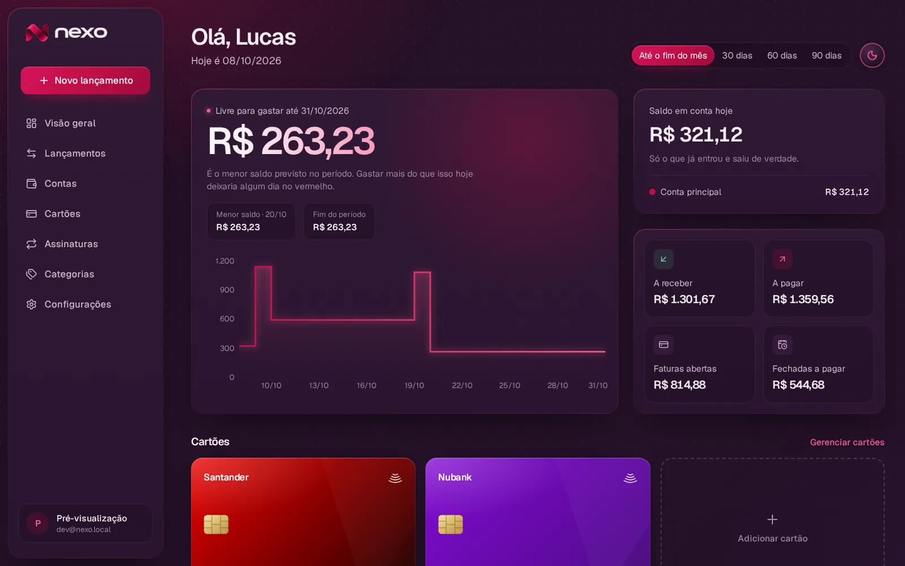
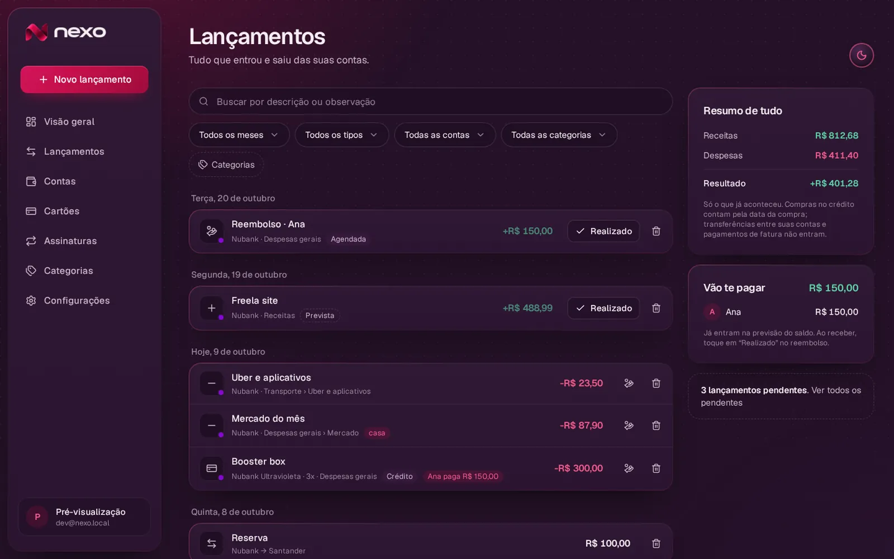
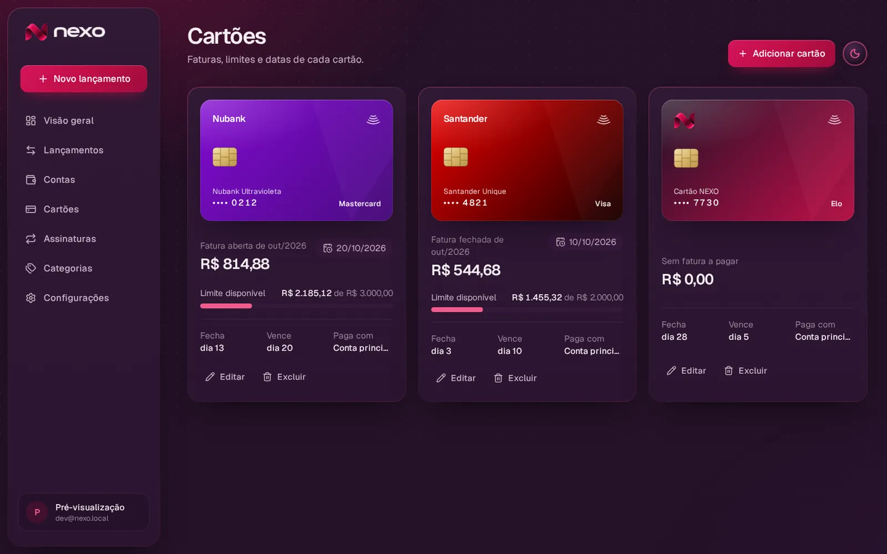
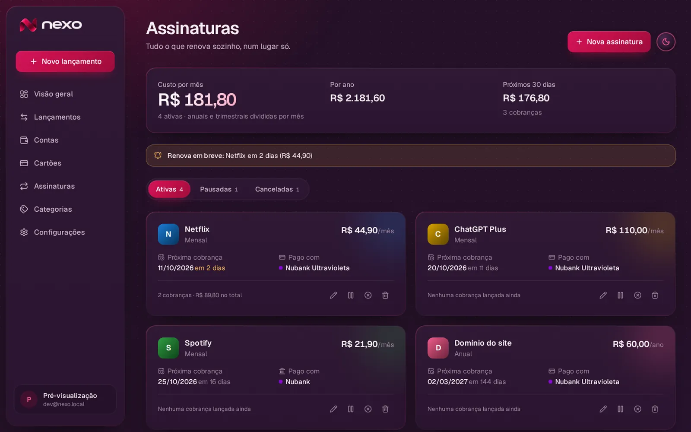
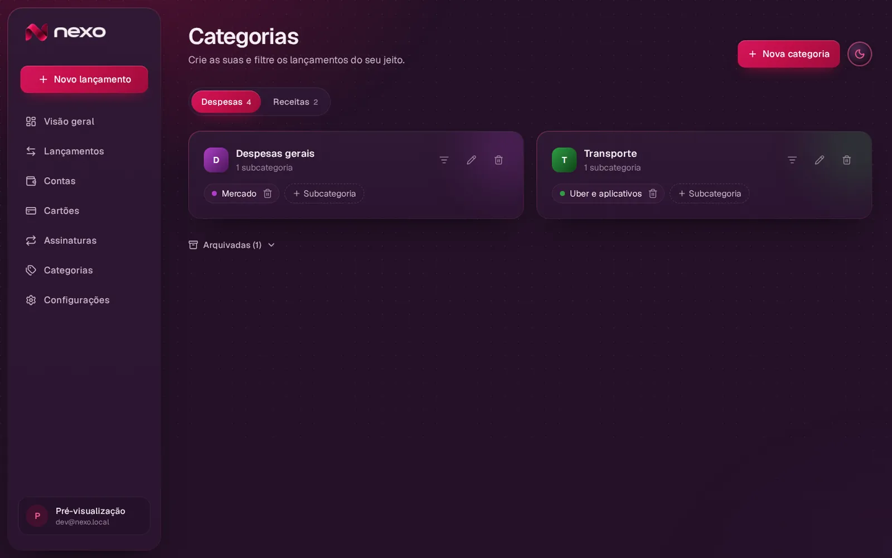

<p align="center">
  
</p>

<h3 align="center">Seu dinheiro. Tudo conectado.</h3>

<p align="center">
  
  
  
  
  
  
  
</p>

<p align="center">
  <a href="https://nexo-gamma-one.vercel.app"><b>🔗 Acessar o app</b></a>
</p>

<p align="center">
  
</p>

<table align="center">
  <tr>
    <td></td>
    <td></td>
  </tr>
  <tr>
    <td></td>
    <td></td>
  </tr>
</table>

<p align="center"><sub>Telas da prévia de desenvolvimento, com dados fictícios.</sub></p>

---

Gestão financeira pessoal: contas, cartões, faturas, parcelamentos, assinaturas e a projeção do saldo dia a dia.

Next.js 15 (App Router) · React 19 · TypeScript estrito · Tailwind CSS 4 · Radix · Motion · Recharts · Supabase (Postgres + Auth + RLS) · Zod · Vitest · Playwright.

## Estado atual

| Etapa | Situação |
|---|---|
| Fundação: arquitetura, banco, regras financeiras, design system | ✅ |
| 1 — Autenticação, estrutura visual e navegação | ✅ |
| 2 — Contas, transações e saldos (telas) | ✅ contas, lançamentos, transferências, ajuste de saldo, lançamento rápido |
| 3 — Cartões, faturas e parcelamentos (telas) | cadastro, edição e exclusão de cartões prontos; compras e faturas a seguir |
| 4 — Dashboard e linha do tempo | dashboard pronto; tela da linha do tempo pendente |
| 5 — Assinaturas, categorias e orçamentos | categorias e assinaturas prontas; orçamentos a seguir |
| 6 — Simulador, relatórios e metas | motor do simulador pronto |
| 7 — Notificações, segurança e refinamento | RLS/auditoria prontos |

O **motor financeiro** (`src/domain`) e o **banco** (`supabase/migrations`) já cobrem as regras de todas as etapas e estão testados; as próximas etapas constroem as telas sobre eles.

## Como rodar

1. Crie um projeto em [supabase.com](https://supabase.com) e aplique as migrations:
   ```bash
   npx supabase link --project-ref <ref>
   npx supabase db push
   ```
   Ou, pelo painel, cole cada arquivo de `supabase/migrations` no **SQL Editor**, em ordem. São 11 arquivos; um deles cria o bucket privado `card-images` (logos e imagens dos cartões).
2. Em **Authentication → URL Configuration**, adicione `http://localhost:3000/auth/confirm` às Redirect URLs. Nos templates de e-mail de confirmação e recuperação, use o link `{{ .SiteURL }}/auth/confirm?token_hash={{ .TokenHash }}&type={{ .Type }}`.
3. `cp .env.example .env.local` e preencha as chaves. A `SUPABASE_SERVICE_ROLE_KEY` só é usada no servidor (exclusão de conta) e nunca vai ao navegador.
4. `npm install && npm run dev` (usa o Turbopack: a primeira abertura de cada página compila em poucos segundos; as seguintes são instantâneas).

Para a versão mais rápida possível no seu computador: `npm run build && npm start`.

## Logos dos bancos

O NEXO não traz as logos oficiais dos bancos embutidas. Em **Cartões → Adicionar/Editar**, cada cartão aceita:
- **Logo da instituição**: aparece no canto do cartão (PNG com fundo transparente fica melhor);
- **Imagem do cartão**: uma foto ou arte do seu cartão, usada como fundo inteiro.

As imagens (PNG, JPG ou WebP, até 2 MB) ficam no Supabase Storage, numa pasta visível só para você. Sem imagem, o cartão usa as cores da instituição escolhida.

Sem Supabase configurado, a tela de login mostra o passo a passo de configuração. A página **/diagnostico** confere cada item (chaves, conexão, migrations, confirmação de e-mail, chave secreta e bucket) e diz o que corrigir.

O site real começa zerado. A prévia com dados fictícios (`/dev/preview`) só existe em desenvolvimento com `NEXO_DEV_PREVIEW=1` e é usada pelos testes de tela.

## Testes

```bash
npm test            # domínio + banco (Vitest)
npm run test:e2e    # Playwright (desktop e smartphone)
```

- `src/domain/__tests__` — regras financeiras puras.
- `supabase/tests` — executa as **migrations reais** num PostgreSQL 18 (PGlite) com um `auth` equivalente ao do Supabase e testa RLS, isolamento entre usuários, atomicidade de transferências, idempotência, cascata na exclusão de conta.
- `e2e/ui.spec.ts` — responsividade sem rolagem horizontal, navegação por dispositivo, troca e persistência de tema, proteção de rotas.
- `e2e/auth.spec.ts` — persistência após logout/login contra um projeto Supabase de teste (`E2E_EMAIL`, `E2E_PASSWORD`).

## Estrutura

```
src/
  domain/          regras financeiras puras (centavos, ciclos de fatura, timeline, recorrência, simulador)
  lib/supabase/    clientes servidor/navegador/admin (admin só no servidor)
  lib/data/        carga dos dados do usuário → tipos do domínio
  lib/theme/       tema claro/escuro (perfil + cookie)
  components/      brand, shell (sidebar/barra inferior), ui, dashboard, settings
  app/(auth)/      entrar, cadastro, recuperar senha, nova senha
  app/(app)/       visão geral, configurações (perfil, demo, exportação, exclusão)
  middleware.ts    proteção de rotas e renovação de sessão
supabase/
  migrations/      esquema, RLS, funções atômicas, auditoria
  tests/           testes do banco
docs/              regras financeiras e arquitetura
```

Veja [docs/REGRAS-FINANCEIRAS.md](docs/REGRAS-FINANCEIRAS.md) e [docs/ARQUITETURA.md](docs/ARQUITETURA.md).

---

## 👨‍💻 Autor

<p>
  Feito por <b>Lorenzo Orsetti</b><br/>
  <a href="https://lorenzo-or7.github.io">
    
  </a>
  <a href="https://www.linkedin.com/in/lorenzo-orsetti-031906349/">
    
  </a>
  <a href="https://github.com/lorenzo-or7">
    
  </a>
</p>
